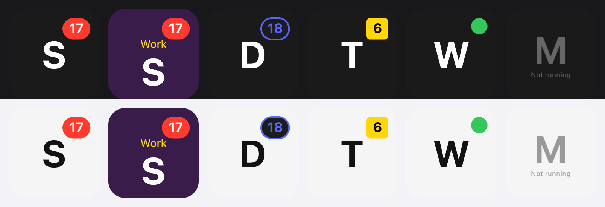

<p align="center">
  
</p>

<h1 align="center">App Badges for Macro Deck</h1>

<p align="center">
  Unread counts from WhatsApp, Slack, Discord, Telegram or any other Mac app, on a <a href="https://macro-deck.app">Macro Deck 3</a> tile.
</p>

<p align="center">
  <a href="https://github.com/ashrafabulsoud/macro-deck-app-badges/releases"><b>Download</b></a>
  &nbsp;·&nbsp;
  <a href="https://github.com/ashrafabulsoud/macro-deck-app-badges/issues/new?template=feedback.yml"><b>Share feedback</b></a>
  &nbsp;·&nbsp;
  <a href="https://github.com/ashrafabulsoud/macro-deck-app-badges/issues/new?template=bug_report.yml"><b>Report a bug</b></a>
  &nbsp;·&nbsp;
  <a href="https://github.com/ashrafabulsoud/macro-deck-app-badges/issues/new?template=feature_request.yml"><b>Suggest an idea</b></a>
</p>



<sub>The picture uses each app's first letter in place of its icon. On your deck the tile shows the real app icon.</sub>

> **Testers wanted.** This is an early version that is not in the Macro Deck Store yet. Install it, use it
> for a few days, and tell me how it went. See [Giving feedback](#giving-feedback).

## Contents

- [What it does](#what-it-does)
- [Install](#install)
- [Quick start](#quick-start)
- [Reading the tile](#reading-the-tile)
- [Settings](#settings)
- [Troubleshooting](#troubleshooting)
- [Known limitations](#known-limitations)
- [Giving feedback](#giving-feedback)
- [Privacy](#privacy)
- [For developers](#for-developers)

## What it does

The red number on a Dock icon tells you how many unread messages an app has. This plugin puts that number
on your deck, so you see it without looking at the Dock.

- **One widget, any app.** Add an **App badge** tile and pick the app: WhatsApp, Slack, Discord, Telegram,
  Messages, Mail, or anything else that shows a badge in the Dock.
- **Live count.** The badge updates within about two seconds of the Dock.
- **Tap to open** the app.
- **Shows the app's own icon**, dimmed when the app is not running.
- **Styles like Macro Deck's own buttons**: background, label, label color, font, accent color and border,
  plus the icon size and the badge's position, size, style and text color.

## Install

You need **Macro Deck 3** on a **Mac with Apple silicon**. Other platforms are not supported yet.

1. Download `com.ashrafabulsoud.app-badges-<version>.macroDeckPlugin` from the
   [latest release](https://github.com/ashrafabulsoud/macro-deck-app-badges/releases).
2. In Macro Deck, install it from the file (open the plugins page and choose to install a plugin from a
   file, or double-click the downloaded file if `.macroDeckPlugin` files open with Macro Deck).
3. Macro Deck warns that the plugin is **not signed**. That is expected for a test version that does not come
   from the Store yet: confirm to install it.

To update, install the newer file the same way. Your widgets and their settings stay as they are.

## Quick start

1. Open a folder in Macro Deck and add a widget. Pick **App badge**.
2. Edit the widget and choose an app under **App**. The list is searchable: type a few letters.
3. Save. The tile shows the app's icon, and the red badge appears as soon as the app has unread messages.
4. Tap the tile to open the app.

Want one tile per chat app? Add an **App badge** widget for each and pick a different app in each.

## Reading the tile

| The tile shows | Meaning |
| --- | --- |
| App icon with a red **17** | The app is running and has 17 unread items, as in the Dock. |
| **99+** | More than 99. |
| A red dot without a number | The app shows a badge without a count, or you picked the **Dot only** style. |
| App icon, no badge | The app is running and has nothing unread. |
| Grey, faded icon and **Not running** | The app is closed, so it has no badge. Tap to open it. |
| **?** and **App not found** | The chosen app is no longer installed or was moved. Edit the widget and pick it again. |
| **Choose an app** | The widget has no app yet. Edit it. |

## Settings

Edit the widget to change these. Every option in the editor has a short description under it.

### App and icon

| Setting | Default | What it does |
| --- | --- | --- |
| App | | The app whose badge the tile shows. |
| Icon size (%) | 70 | How much of the tile the icon fills, from 30 to 90. Lower it to make room for a label. |

### Message badge

| Setting | Default | What it does |
| --- | --- | --- |
| Badge position | Top right | Top right, top left, bottom right or bottom left. |
| Badge style | Pill | **Pill** like the Dock, **Rounded square**, **Outline** (a colored ring with the number inside), or **Dot only** (no number). |
| Badge size (%) | 100 | From 50 to 200. |
| Badge text color | White | The color of the number. An outline badge uses the badge color unless you change this. |
| Accent color | Dock red | The badge color. |

### Appearance

The same settings as Macro Deck's own buttons:

| Setting | What it does |
| --- | --- |
| Label | Optional text, for example *Work* to tell two Slack tiles apart. Empty means an icon-only tile. |
| Background color | The tile color, or **Transparent** to show the folder background. Text switches to white or dark to stay readable on it. |
| Label color, font, size (%) | Style the label. They only take effect once you type a label. |
| Alignment | Moves the label left, center or right. |
| Label position | Above the icon, over it, or below it (default). |
| Border | A ring around the tile, steady or animated. |

Macro Deck's appearance actions (**Set Label**, **Set Label Color**, **Set Label Font**, **Set Background
Color**, **Set Accent Color**, **Set Border**) work on App badge tiles too, so a macro can restyle them.

## Troubleshooting

| Problem | What to try |
| --- | --- |
| App badge is not in the widget picker | Make sure the plugin is installed and enabled on Macro Deck's plugins page, then reopen the picker. Check that you are on a Mac with Apple silicon. |
| My app is not in the list | The list shows apps in `/Applications`, `/System/Applications` and `~/Applications`, including one folder level down. Apps elsewhere are not listed. A newly installed app can take up to 10 minutes to appear. |
| The Dock shows a number but the tile does not | The count comes from the same place as the Dock's badge. If the app was just opened, wait a few seconds. If it stays empty, [report a bug](https://github.com/ashrafabulsoud/macro-deck-app-badges/issues/new?template=bug_report.yml) with the app's name. |
| An app shows no badge at all | Some apps only badge the Dock icon when their own notification or badge setting is on. Check the app's settings and **System Settings > Notifications** for that app (allow badges). |
| Size (%) does nothing | It sizes the label. Type a label first. |
| Tapping does nothing | Check Macro Deck's log viewer for a line that mentions *Opening ... failed* and include it in a bug report. |
| The tile on my hardware deck shows no icon or count | Expected: hardware decks show a widget's label and colors only. Use the desktop app, web client or Companion app. |

## Known limitations

- **macOS on Apple silicon only** for now. Windows and Linux would need a different way to read unread counts.
- **Only running apps have badges.** Like the Dock, a closed app has no count, even if messages are waiting.
- **The count is whatever the app puts on its Dock icon.** If the app counts differently from what you
  expect (for example muted chats), the tile shows the same as the Dock.
- **It uses `lsappinfo`**, a tool that comes with macOS but is not officially documented by Apple. A future
  macOS update could change it; if counts stop appearing after an update, please report it.
- **Hardware decks** show the label and colors, not the icon or the live count.
- **App icons** come from the app's own icon file. A few apps ship only an asset-catalog icon; for those the
  tile shows the app's first letter instead.

## Giving feedback

This version is for testing, and your experience is what decides what changes next.

| I want to... | Use |
| --- | --- |
| Tell you how it works for me | [**Share feedback**](https://github.com/ashrafabulsoud/macro-deck-app-badges/issues/new?template=feedback.yml) |
| Report something broken | [**Report a bug**](https://github.com/ashrafabulsoud/macro-deck-app-badges/issues/new?template=bug_report.yml) |
| Ask for a feature | [**Suggest an idea**](https://github.com/ashrafabulsoud/macro-deck-app-badges/issues/new?template=feature_request.yml) |
| See what others reported | [**All issues**](https://github.com/ashrafabulsoud/macro-deck-app-badges/issues) |

You need a free GitHub account to open an issue. Each link opens a short form.

**A good bug report includes:**

1. **Which app** the tile is for, and what the Dock shows for it at the same moment.
2. **What you expected** and **what happened instead**.
3. **Versions**: the plugin version, the Macro Deck version and your macOS version.
4. **Your widget settings** if you changed them.
5. **A screenshot** of the tile next to the Dock. Drag it into the issue form.
6. **Log lines**: open Macro Deck's log viewer, look for lines that mention *App Badges* or *badge*, and paste them.

Before opening a new issue, take a quick look at the [existing ones](https://github.com/ashrafabulsoud/macro-deck-app-badges/issues).
If yours is already there, add a comment or a thumbs-up instead. That tells me how many people it affects.

## Privacy

- The plugin makes **no network connections** and collects nothing.
- To read badges it runs macOS's own `lsappinfo` for the apps you put on tiles, every two seconds while a tile
  is on screen. It reads only the badge text (the number), never message contents. Nothing runs while no
  App badge tile is shown.
- To list your apps and draw their icons it reads the apps' `Info.plist` with `plutil` and converts their
  icon with `sips`. Icons are sent only to your Macro Deck clients.
- Tapping a tile runs `open -a` with the app you picked.
- No macOS permission prompt is needed for any of this.

## For developers

Built with the Macro Deck 3 plugin SDK (`3.0.0-beta.19`, pinned in `Directory.Packages.props`). You need the
.NET 10 SDK and the plugin CLI at the same version, on macOS:

```bash
dotnet tool install --global MacroDeck.Plugin.Cli --version 3.0.0-beta.19
dotnet build -c Release -warnaserror
dotnet test -c Release
macrodeck-plugin test --project src/AppBadges
macrodeck-plugin preview render --project src/AppBadges --output /tmp/app-badges-previews
macrodeck-plugin build --source src/AppBadges --output ./artifacts
```

To run it against your own Macro Deck while you work on it, turn on Developer Mode in Macro Deck, run
`macrodeck-plugin run --project src/AppBadges`, and approve the pairing request.

The macOS parts sit behind small interfaces (`IBadgeReader`, `IAppCatalog`, `IAppLauncher` in `src/AppBadges/Badges`),
so another platform needs only new implementations of those. Code layout and the rules the code follows are in
[AGENTS.md](AGENTS.md). Pull requests are welcome; please open an issue first for anything larger than a small fix.

## License

MIT, see [LICENSE](LICENSE). Bundled third-party components are listed in
[THIRD-PARTY-NOTICES](THIRD-PARTY-NOTICES). The plugin icon was created with AI assistance, as declared in the
plugin manifest. App names such as WhatsApp, Slack, Discord and Telegram are trademarks of their owners; this
plugin is not affiliated with or endorsed by them.
